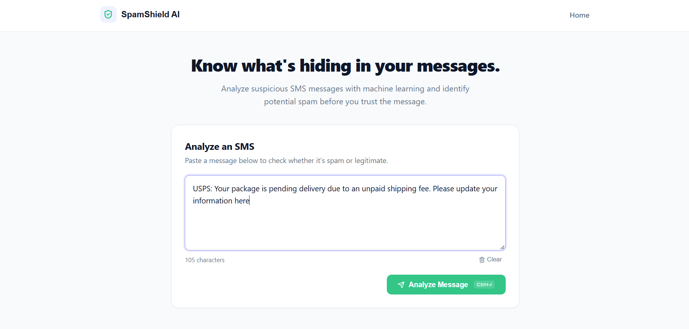
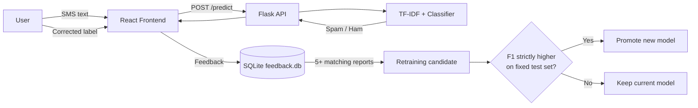

# Multilingual SMS Spam Detection with Consensus-Based Adaptive Learning


An end-to-end machine learning application that classifies SMS messages as **Spam** or **Ham (legitimate)** in **English and Hindi**. It combines a comparative NLP experiment pipeline, a Flask API with a React interface, and a feedback-driven retraining workflow that only promotes a new model when it measurably improves on the current one.





## Table of Contents

- [Key Features](#key-features)
- [System Overview](#system-overview)
- [Dataset](#dataset)
- [Methodology](#methodology)
- [Results](#results)
- [Feedback Loop and Adaptive Learning](#feedback-loop-and-adaptive-learning)
- [Screenshots](#screenshots)
- [Project Structure](#project-structure)
- [Getting Started](#getting-started)
- [Limitations](#limitations)
- [Roadmap](#roadmap)

## Key Features

- **Bilingual classification:** Handles English and Hindi (Unicode) messages in a single model.
- **Comparative modelling:** Benchmarks Multinomial Naive Bayes, Logistic Regression, and Linear SVM on TF-IDF features, including word n-gram variants.
- **Feature-selection experiments:** Evaluates Information Gain across different feature counts.
- **Full-stack application:** React frontend backed by a Flask prediction API.
- **Persistent user feedback:** Corrections are stored in SQLite (`feedback.db`) with the original message, model prediction, corrected label, and timestamp.
- **Consensus-based retraining trigger:** Unused feedback is grouped by normalised message and corrected label; a group becomes a retraining candidate after at least **5 matching reports**.
- **F1-gated model promotion:** A retrained model replaces the current one only if its F1-score is strictly higher.

## System Overview



## Dataset

The project uses a dataset of English and Hindi SMS messages.

| Detail | Count |
| --- | ---: |
| Messages after duplicate removal | 10,288 |
| English messages | 5,156 |
| Hindi messages | 5,132 |
| Ham messages | 9,017 |
| Spam messages | 1,271 |
| Duplicate records removed | 1,725 |

No null values were found in the selected data. The classes are imbalanced (about 12% spam), so evaluation reports spam precision, spam recall, F1-score, and the confusion matrix rather than relying on accuracy alone.

## Methodology

1. **Data preparation:** Select the English and Hindi subsets and remove duplicate records.
2. **Preprocessing:** Build a cleaned-text field with normalised casing and whitespace, while preserving signal-bearing content such as punctuation, numbers, URLs, currency symbols, and Hindi Unicode characters.
3. **Splitting:** Use a stratified train/test split.
4. **Feature extraction:** Apply TF-IDF with word unigrams and unigram-plus-bigram variants.
5. **Model training:** Train and compare Multinomial Naive Bayes, Logistic Regression, and Linear SVM.
6. **Feature selection:** Evaluate Information Gain with varying feature counts.
7. **Evaluation:** Compare models using precision, recall, F1-score, and confusion matrices.
8. **Deployment:** Serve predictions through the Flask API and React interface.
9. **Adaptation:** Collect feedback in SQLite and apply the consensus threshold and F1 acceptance rule.

## Results

F1-scores from the TF-IDF unigram + bigram experiment:

| Model | F1-score |
| --- | ---: |
| Multinomial Naive Bayes | 65.96% |
| Logistic Regression | 82.29% |
| **Linear SVM** | **82.87%** |

> These figures come from a single experimental configuration and may not generalise to new messages. Real-world performance can differ from offline results.

<!-- Add a model-comparison chart and confusion matrix:


-->

## Feedback Loop and Adaptive Learning

1. A user submits an SMS and receives a prediction.
2. The user can submit a corrected label, which is saved to `feedback.db` with the message, the model's prediction, and a timestamp.
3. Unused feedback is grouped by normalised message and corrected label.
4. A group reaching **5 matching reports** becomes eligible for retraining.
5. The candidate model is evaluated against the current model.
6. The candidate is promoted only if its F1-score is **strictly greater**; otherwise the current model is retained.

**Evaluation integrity:** Both models should be compared on the same fixed held-out test set, kept separate from any feedback used for training. Model versions and scores should be recorded so that every promotion is auditable.

## Project Structure

```text
sms-spam-detection/
├── backend/         # Flask API
├── data/            # Dataset and feedback database
├── database/        # Database utilities
├── frontend/        # React application
├── models/          # Trained model artifacts
├── notebooks/       # Experiment notebooks
├── src/             # Preprocessing and ML code
├── requirements.txt
└── README.md
```

## Getting Started

### Prerequisites

- Python 3.9+
- Node.js 18+ and npm

### Installation

```bash
git clone https://github.com/pratitipatlia/sms-spam-detection.git
cd sms-spam-detection

python -m venv .venv
source .venv/bin/activate        # Windows: .venv\Scripts\Activate.ps1

pip install -r requirements.txt
```

### Running the application

**Backend**

```bash
cd backend
python app.py
```

**Frontend** (in a second terminal)

```bash
cd frontend
npm install
npm start
```

Open the URL printed by the React dev server. If the frontend needs the API address, set it in the frontend's environment configuration. Do not commit secrets or credentials.

## Limitations

- **Class imbalance:** Spam recall and F1 matter alongside accuracy.
- **Language coverage:** Performance depends on the dataset's languages and message patterns; Hinglish (code-mixed) text is not explicitly covered.
- **Feedback quality:** User feedback can be noisy or wrong, so a retraining trigger does not guarantee a better model. The F1 gate exists to guard against this.
- **Consensus strength:** The schema does not verify that reports come from distinct users, so the 5-report threshold means *repeated matching feedback*, not independent consensus, until distinct-user validation is added.
- **Offline vs. real-world:** Offline test scores may not reflect live performance.

## Roadmap

- [ ] Automated tests for preprocessing, prediction endpoints, feedback handling, and model promotion
- [ ] Reproducible training and evaluation script with metrics saved per model version
- [ ] GitHub Actions CI for pushes and pull requests
- [ ] Docker setup and a hosted live demo
- [ ] Distinct-user validation for feedback
- [ ] Tracking of precision, recall, F1, confusion matrices, model size, and inference latency across versions

## Repository

[github.com/pratitipatlia/sms-spam-detection](https://github.com/pratitipatlia/sms-spam-detection)
